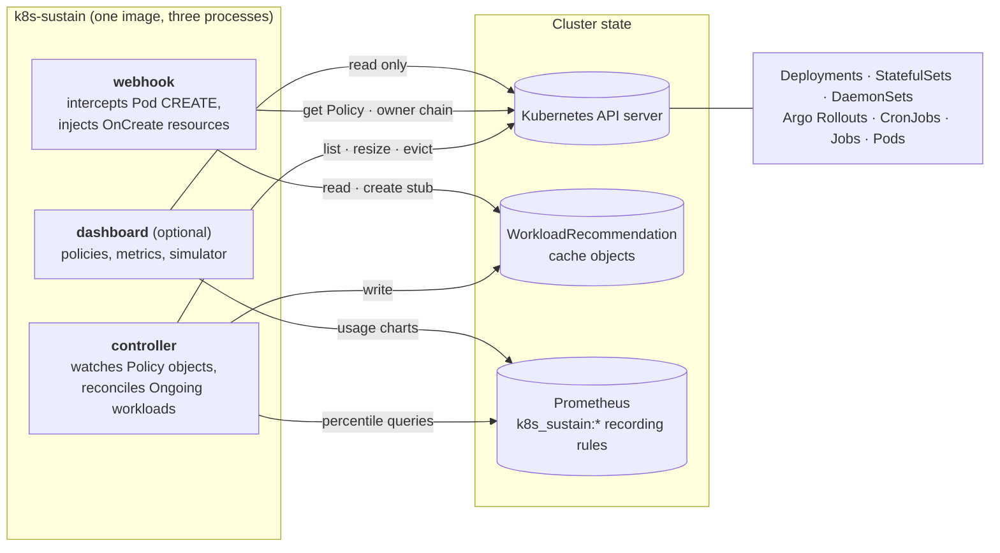

# Architecture

k8s-sustain is split into three independent components that run as separate processes (different container args in the same image):

## Controller (`k8s-sustain start`)

The controller is a standard [controller-runtime](https://github.com/kubernetes-sigs/controller-runtime) reconciler that watches `Policy` objects.

**Reconcile loop:** a `Policy` event (create, spec change, deletion, periodic requeue) takes an **inventory** of the identities the policy can govern, then runs one pass over them in three phases in order — **claim**, **computation**, **application** — which reports, per identity, its outcome and what happened to each of its workloads. The policy's health series, `Ready` condition and next requeue are derived from that report. Only computation talks to Prometheus. Independent `Policy` objects reconcile in parallel, bounded by `--policy-concurrency-limit` (default 10) — a separate knob from the per-workload fan-out inside the computation phase.

The controller requeues after `--reconcile-interval` (default `5m`), or sooner when a workload's retry falls due first (see [Application](#application)).

### Inventory

`internal/inventory` turns workload objects into **identities** — one namespace, kind and name, possibly spanning several objects under [owner-name grouping](../guides/standalone-pods-and-grouping.md) — and is the only place that does. The dashboard reads identities from it too, so both apply the same rules:

- **Members** are the live objects of an identity. A finished standalone Job and a CronJob's Jobs are never members; a bare pod is one when it has no controller owner and a valid `k8s.sustain.io/owner-name`
- Each member is **governed** by the Policy it opts into (see [resolution order](../reference/annotation.md#resolution-order)) when that Policy exists, manages its kind and its selector matches it — its namespace and its pod template's labels. `internal/governance` makes that decision, for the webhook and the OOM watcher too ([ADR 0004](../adr/0004-governance-is-decided-on-the-pod-template.md))
- An identity is governed by its members' Policy when they agree, and is **Conflicted** when they name different Policies — then no Policy governs it (see [Conflicted identities](workload-recommendations.md#conflicted-identities))
- An identity with no member left but a `WorkloadRecommendation` is **Departed**; its Policy is the one its `WorkloadRecommendation` names, while that Policy still covers its namespace and kind
- Its containers are the union of its governed members' containers (the newest member's declaration wins for a name several declare), and its age runs from its earliest member or from its `WorkloadRecommendation`'s creation, whichever is older

A reconcile reads only the namespaces in `selector.namespaces` (all when empty) and the kinds the policy manages. Every member of an identity shares its namespace and kind, so the narrowed read still sees whole identities. Reads go through the controller's informer cache.

### Claim

For every live identity the policy governs, claim its `WorkloadRecommendation`: create it when missing, or adopt it (its `spec.policy` and policy label become this Policy's), replace its `status.observedResources` snapshot when it differs from the members' containers, and clear `status.departed`. Only the governing Policy claims it, so two Policies never rewrite the same object back and forth. An adopted object keeps the previous Policy's Recommendation, which the webhook withholds until this Policy computes its own ([ADR 0003](../adr/0003-a-recommendation-is-served-only-to-its-policy.md)).

The claim issues **no Prometheus queries**, so expect one `WorkloadRecommendation` per governed identity from the first reconcile onward, most of them briefly empty.

### Computation

The work-list is **every identity the policy governs**, Departed ones included, so an identity with no live member — a completed Job, a bare-pod group between runs — is still recomputed on every cycle. A Conflicted identity is not on it.

- Set aside workloads in retry backoff from a previous transient failure. The decision is taken once, before the fetch, and holds until the application phase; an identity whose every workload is set aside is not fetched
- Fetch every other identity's Prometheus inputs in **one batched call per policy** (see [Recommendation Pipeline](recommendation-pipeline.md#how-the-data-is-fetched)) — a handful of queries for the whole policy instead of several per workload. Every kind batches identically, including `Job` and `Pod`
- Compute the fetched identities in parallel (bounded by `--workload-concurrency-limit`, default 5): detect autoscalers (HPA / KEDA `ScaledObject`) targeting the workload — read-only, no patches — and compute a per-container recommendation with its [trace](recommendation-pipeline.md#trace) (see [Recommendation Pipeline](recommendation-pipeline.md))
- Each identity leaves this pass with one outcome: a recommendation, too young, no data, fetch failed, or not fetched
- The unit is the **identity**, not the workload object: a group of workloads sharing an owner-name produces one computation and one write, against the union of the members' containers
- Record the result in the `WorkloadRecommendation` in one status write, regardless of update mode and before any pod is touched — this keeps `OnCreate` workloads visible on the dashboard and is the webhook's only source of recommendations at admission (it never queries Prometheus itself). An unchanged result costs no write
- The record holds the outcome in `status.outcome` (`Computed`, `NoData`, `TooYoung`, `FetchFailed`) and whether the identity is departed in `status.departed`. A `Computed` outcome also stores the Recommendation and the Policy that computed it (`status.computedBy`); any other outcome keeps the last Recommendation — a last-known-good is never overwritten. The identity is recomputed on the next cycle and converges as soon as Prometheus has enough history
- A **departed** identity stops here. It is computed and cached so the webhook can inject it into that identity's *next* pod, but there are no running pods to align

Departed refreshes are counted in `k8s_sustain_wlr_refresh_total{namespace, owner_kind, outcome}`; see [Metrics](../reference/metrics.md#k8s_sustain_wlr_refresh_total).

A Conflicted identity is only recorded: `status.outcome: Conflicted` on its `WorkloadRecommendation`, whose `spec.policy` and Recommendation stay as the last governing Policy left them.

### Application

Only the governed members of live identities in `Ongoing` mode are applied, and only when the identity's result was recorded: an identity whose `WorkloadRecommendation` could not be claimed or written is left alone that cycle and counted as failed, because the replacement pods of an eviction read the stored Recommendation at admission and would start on template resources. `OnCreate`-mode workloads stop after computation — the recommendation is cached but never applied by the controller, because resource injection at pod creation is the webhook's job — and a departed identity has no pods to apply anything to, so it stopped in the previous phase.

- If recommend-only is in effect, log the recommendation and skip patching — see [Recommend-only mode](update-modes.md#recommend-only-mode)
- Recycle stale running pods: in place through the `pods/resize` subresource on k8s ≥ 1.33, PDB-respecting eviction otherwise, with the webhook injecting the latest resources into replacement pods. Only pods owned by the member are touched — see [Eviction safeguards](update-modes.md#eviction-safeguards)
- CronJob, Job and bare-pod pods are resized in place only, never evicted — see [Kinds that are never evicted](in-place-updates.md#kinds-that-are-never-evicted)
- Under owner-name grouping, every member is applied independently against the identity's one shared recommendation, narrowed to the containers that member actually declares
- Emit a `ResourcesUpdated` event on the workload object **only when at least one pod was actually resized in place or evicted** in that reconcile. The workload's pod template is never patched, so it permanently differs from the recommendation — a reconcile that finds every pod already at target stays silent. The message names the pod count and the containers (e.g. `Updated resources on 2 pod(s) for containers: [app]`); the applied values are on each pod's own `ResizeStarted` event. The events API groups events by object and reason, so updates of the same workload less than ~6 minutes apart are folded into one Event whose `series.count` and `lastObservedTime` advance
- On transient failure (Prometheus error or timeout, API 5xx, 404 Not Found, 409 Conflict or 429), back the workload off exponentially (30s base, doubling with each consecutive transient failure, 5min cap) and emit a `ReconciliationRetryScheduled` warning event on the workload naming when it is retried. The policy's next reconcile is scheduled for the earliest such retry when it comes before `--reconcile-interval`, so that time is when the retry runs
- On permanent failure (an API rejection such as 403, 401 or Invalid, typically missing RBAC on `pods/eviction` or `pods/resize`, or a workload the controller refuses to apply to, such as one without a UID or a valid selector), emit a `ReconciliationFailed` warning event once, when the workload enters the failure, and retry it on every reconcile without backoff, so a fix is picked up without a restart
- A workload whose last failure, transient or permanent, has not been followed by a success is **Blocked**, and so is its identity. A workload left alone because its identity's recommendation could not be stored counts as a failure of the `store` step. Only shutdown, never a timeout of a single call, ends a reconcile without counting its failures
- The policy is `Ready` only when no workload failed this reconcile and none of its identities is Blocked, including those whose workloads this reconcile set aside in backoff (see [Policy status](../reference/policy.md#status)). The controller's own status writes do not trigger a reconcile; only a new `generation` (a spec change or a deletion), the interval, a due retry or a live OOM kill does

Up to `--policy-concurrency-limit` policies (10 by default) fetch at once, each running up to 8 shard queries concurrently, more while a failed shard is re-queried one identity at a time — enough to burst well past Prometheus's own `--query.max-concurrency` (default 20, shared with every other consumer of that server: Grafana dashboards, alerting rules). `--prometheus-max-inflight` (default 8) is a separate, global cap on concurrent Prometheus queries across the whole controller process — it throttles the client itself rather than the fan-out, so it protects Prometheus even if the concurrency limits are turned up.

### Pod OOM watcher

A second controller-runtime reconciler runs alongside the Policy reconciler and watches `Pod` objects cluster-wide, filtered by a local event predicate to those carrying the `k8s.sustain.io/policy` annotation OR a fresh `OOMKilled` container status. It exists to close the multi-minute latency window between an OOM kill and the next recording-rule-driven reconcile (kube-state-metrics scrape → Prometheus scrape → 1m rule evaluation → 5–10m reconcile interval).

When a container's `LastTerminationState.Terminated.Reason == "OOMKilled"` is observed for a kill not already handled, the watcher decides which Policy governs the pod, through the same `internal/governance` decision as every other reader, and, if one does:

- Resolves the pod's top-level workload owner and records the kill in an in-memory cache keyed by `(namespace, ownerKind, ownerName, container)`, deduplicated by restart count and termination time
- Records the memory limit the kubelet had actually applied to the container (`ContainerStatus.Resources`, falling back to the pod spec), so the recommender has a bump anchor before Prometheus surfaces the OOM-time limit
- Enqueues the governing Policy for immediate reconcile via a `source.Channel` wired into the Policy reconciler's work queue, and counts the kill in `k8s_sustain_oom_observed_total`. A kill of a pod no Policy governs — one whose Policy does not select it, say — is neither recorded, nor counted, nor triggers anything.

The controller's recommendation inputs merge the cache's kills into each identity's OOM inputs after the Prometheus fetch, and the [OOM floor signal](recommendation-pipeline.md#signals) reads them together with the Prometheus 24h window: a kill the watcher saw in the last 30 minutes counts as a recent OOM for that container only — equivalent to the per-container `workload_oom_24h` recency signal — and feeds the OOM-floor stage of the [Recommendation Pipeline](recommendation-pipeline.md#stages). The math and bump factor are unchanged — the watcher only makes the trigger and the signal source fresher.

**Operational notes.** The cache is in-memory and lives only for the lifetime of the controller process; it keeps a kill for the same 30 minutes the OOM floor counts it as recent. On restart, the 24h Prometheus history (`k8s_sustain:workload_oom_24h`, `k8s_sustain:container_oom_limit_24h:bytes`) repopulates the floor on the next reconcile. The watcher is leader-elected like other controllers — non-leaders idle.

## Admission Webhook (`k8s-sustain webhook`)

The webhook is a [mutating admission webhook](https://kubernetes.io/docs/reference/access-authn-authz/admission-controllers/#mutatingadmissionwebhook) that intercepts `pods/CREATE` requests.

**Admission flow:**

1. Pod creation request arrives at the API server
2. API server calls `POST /mutate` on the webhook service
3. The webhook first **decides**, from reads alone, what admitting the pod does. The decision ends in one reason from a closed set (a governance refusal, a verdict that injects nothing, `no-container-matches`, `recommend-only`, `at-recommendation`, `injected`, or a failed read), logged with the admission:
    - which Policy governs the pod, as the controller decides it (`internal/governance`): it resolves the pod's policy (see [resolution order](../reference/annotation.md#resolution-order)), checks the Policy exists and its selector accepts the pod's namespace and labels, resolves the pod's owner chain to determine the workload kind (`Pod → ReplicaSet → Deployment` or `Argo Rollout`, `Pod → Job → CronJob` or `Pod → Job` for a standalone Job, `Pod → StatefulSet / DaemonSet`; a `k8s.sustain.io/owner-name` annotation replaces the resolved name, and on a pod with no controller owner makes it a `Pod`-kind identity, see [Standalone Pods & Identity Grouping](../guides/standalone-pods-and-grouping.md)), and checks that the Policy manages that kind at all. Both `OnCreate` **and** `Ongoing` inject — otherwise an `Ongoing` pod would start on template resources and wait for a resize it does not need
    - reads the `WorkloadRecommendation` the controller already cached for that workload — the webhook itself never queries Prometheus — and takes `wlrcache.Read`'s [verdict](workload-recommendations.md#admission-behaviour) on it: inject, or why not. A Recommendation is injected only into pods of the Policy that computed it, and only while it is fresh (30 min) or, for a departed or Conflicted identity, retained
    - narrows the Recommendation to the containers present in this pod, matched by name (its init containers too unless `excludeInitContainers`), and works out the resources to set on each. A container that already has resources set is *not* skipped — the patch replaces whatever the template specified — and a request is never written above its limit: where the pod's limit is below the recommended request, the limit is raised to the request
    - withholds the injection under recommend-only
4. It runs the one effect a decision can call for: when there is **no object at all**, or a departed identity's snapshot lacks one of the pod's containers, it asks for a stub `WorkloadRecommendation` on a detached goroutine, so the controller computes one for the next pod of this workload
5. It responds through one responder, which always allows the pod: an RFC 6902 JSON Patch carrying the resources of an injected admission, and no patch at all otherwise. The webhook never writes anything but container resources; the `k8s.sustain.io/owner-name` annotation is read from the pod, by every reader and by the recording rules through kube-state-metrics, never copied to a label ([ADR 0006](../adr/0006-owner-name-is-read-from-the-annotation.md))
6. The API server applies the patch before persisting the pod

The webhook **fails open** on every path. A failed read, an undecodable pod, even a panic anywhere once the pod is decoded, while deciding or while running and logging what was decided (recovered and counted on [`k8s_sustain_webhook_panic_total`](../reference/metrics.md#k8s_sustain_webhook_panic_total)), ends in a pod allowed unmutated rather than a 500, which a `failurePolicy: Fail` would turn into a rejection; if the webhook is unreachable, `failurePolicy: Ignore` (the default) admits the pod unchanged. See [Admission behaviour](workload-recommendations.md#admission-behaviour) for each outcome.

**Latency budget.** The handler is bounded by a hard 4s deadline on the admission context (under the apiserver's 5s `MutatingWebhookConfiguration` timeout). The only outbound work in the admission path is a handful of Kubernetes API reads: the governance decision's (Policies, owner resolution, the owner's and the Namespace's annotations), which share one 2s budget, and the `WorkloadRecommendation` read, bounded by its own 2s timeout. `Policy`, `WorkloadRecommendation` and `Namespace` reads are served from an informer cache, and a Policy's label selector is compiled once per version of the Policy rather than on every admission.

**Stub writes (the webhook's only write).** The webhook computes nothing, so it never writes a recommendation. It does write one thing, the container snapshot of identities the controller cannot see. When a pod is admitted for a workload identity that has no `WorkloadRecommendation` at all, it creates an empty-status **stub** — recording the admitted pod's container set in `status.observedResources` — and admits the pod unchanged. Creating the object is what puts the identity into the controller's work-list; the [computation phase](#computation) fills in the recommendation on its next cycle, so the next pod of that workload is injected. For a departed identity, or one that never got a snapshot, it replaces the snapshot when the admitted pod's containers differ, so a short-lived identity is computed against its latest run rather than its first.

This is how identities no reconcile ever sees alive — bare pods and standalone Jobs created and deleted between two reconciles — get discovered. See [Cold start](workload-recommendations.md#cold-start-stub-recommendations) for the full lifecycle.

Every `WorkloadRecommendation` write, the controller's and the webhook's, goes through `internal/wlrcache`; so does every judgement on a stored object (what the webhook injects, what the sweep deletes). See [Lifecycle](workload-recommendations.md#lifecycle).

## Dashboard (`k8s-sustain dashboard`)

The dashboard is an optional web UI that provides:

- **Policy overview** — list all policies with status, namespaces, workload types
- **Workload metrics** — interactive CPU and memory time-series charts
- **Policy simulator** — test "what-if" changes to a workload's governing policy (percentiles, headroom, min/max, limits, coordination), assembled and computed exactly as the controller does

It is read-only: it queries the Kubernetes API and Prometheus but never modifies any resources. See the [Dashboard guide](../guides/dashboard.md) for details.

## Recommend-only mode

See [Recommend-only mode](update-modes.md#recommend-only-mode).

## Recommendation pipeline

See [Recommendation Pipeline](recommendation-pipeline.md) for how recommendations are computed.

## Prometheus recording rules

k8s-sustain ships recording rules that the controller and dashboard query. See [Recording Rules](../reference/recording-rules.md) for the full catalogue.

## Policy selection

Each workload explicitly opts into one policy through the `k8s.sustain.io/policy` annotation; the controller, webhook, dashboard and OOM watcher decide which Policy governs it through the same module, `internal/governance`. See [resolution order](../reference/annotation.md#resolution-order).
