# Recommendation Pipeline

This page describes how k8s-sustain produces a per-container recommendation, from raw Prometheus metrics to the final request and limit values applied to a pod.

## Containers covered

Both regular containers and init containers are recommended by default.
Sidecar (restartable) and classic (one-shot) init containers are treated
uniformly: each gets a per-container recommendation derived from its own
Prometheus series. Set `spec.rightSizing.excludeInitContainers: true` on a
policy to skip init containers for the workloads it targets.

The controller recycles a running pod when a regular container or a
restartable sidecar drifts from the recommendation. Drift in classic init
containers does not trigger recycle — they have already exited; the new
requests apply on next pod creation via webhook injection.

## How the data is fetched

Before running the stages below, the controller fetches every identity's Prometheus inputs for a policy in **one batched call per policy**, not one query set per workload. A policy matching 2,000 workloads issues a handful of queries rather than several thousand.

The batch covers the policy's whole work-list, including identities with no live workload object — see [Computation](architecture.md#computation).

Each [signal](#signals) is read one after the other, its identities split into shards of one query each. Shards are sized by a projected sample budget — containers × the signal's samples per container, summed across the workloads packed into a shard — capped by `--query-shard-max-samples` (default `10,000,000`). The CPU and memory usage queries load one sample per minute of their window; the OOM query reads three 24h rules as an instant vector, one sample per rule, so its shards are bounded by the 1,000-workload cap on a shard instead. The cap exists because Prometheus's own `--query.max-samples` (default `50,000,000`) *rejects* an over-budget query outright, which would fail every workload sharing that shard rather than just the excess ones; the default leaves a 5× margin. Independently, `--prometheus-max-inflight` (default 8) caps concurrent queries across the whole controller process so k8s-sustain cannot saturate a Prometheus shared with dashboards and alerting.

A shard query that fails is retried once. If it fails again, its identities are re-queried one shard each, with the same query narrowed to one name, so a shard Prometheus rejects as a whole does not cost its healthy members their inputs — a single identity is just a batch of one. An identity whose CPU or memory query still fails on its own has failed its fetch: each of its workloads is retried with backoff (see [Application](architecture.md#application)). The OOM signal is best-effort: when it cannot be read, the identity is computed without an OOM floor.

Every kind batches identically, including `Job` and `Pod`. An identity whose container count is unknown (no observed-resources snapshot to size it by) gets a shard of its own; a departed identity with no snapshot at all is skipped, since there is no container set to compute against. An identity whose every workload is in retry backoff is not fetched.

The dashboard's simulations read their inputs the same way, one workload or a whole policy per call.

Coverage and health are observed separately and must not be derived from one another — see [Batch fetch coverage vs. failures](../reference/metrics.md#batch-fetch-coverage-vs-failures).

## Signals

A signal is an observed input that contributes one stage to a recommendation. Each one is a module of `internal/recommender` that owns everything about its input — the Policy settings it reads, its query and what that query needs from Prometheus (its [contract](../reference/recording-rules.md#signal-contracts)), how it is parsed, what a shard of it costs, whether an identity can be recommended without it, whether it excuses an identity's age, its stage and its trace stage:

| Signal | Role | Resource | If it cannot be read | Trace stage |
|--------|------|----------|----------------------|-------------|
| CPU usage | base: sets the request | CPU | the identity's fetch fails | `percentile` |
| Memory usage | base: sets the request | memory | the identity's fetch fails | `percentile` |
| OOM floor | adjuster: can only raise the request | memory | computed without the floor | `oomFloor` |

A signal's stage sits on the request side (base or adjuster) or on the limit side (limit adjuster: can only raise the limit the strategy set). No built-in signal is a limit adjuster yet. Base signals combine by max: when several contribute to one resource, the highest contribution sets the request, a tie going to the first in their fixed order, and the trace marks it as the determining stage. An adjuster only replaces the value the base signals set when it is higher. Today each resource has one base signal, its usage.

Every stage of a signal works from the same context: the resource's Policy settings, the container as the identity declares it (the union of its members' containers, with the requests and limits they declare, not a live pod's), the instant the computation runs as of, and, on the limit side, the final request.

Every resource goes through the same fixed chain. Request side: base signals, adjusters, headroom, the min/max clamp, autoscaler coordination. Limit side: the Policy's limit strategy applied to the final request, limit adjusters, then the guard. The order is not configurable.

## Stages

The recommender runs each container through the following stages, in order:

1. **Workload-age gate.** An identity younger than 10 minutes is skipped (`k8s_sustain_recommendation_skipped_total{reason="workload_too_young"}`, log `skipping recommendation: workload too young`), so a near-zero early percentile is never floored to the hard minimum (1m CPU / 1Mi memory) and injected.
    - Age is the *earliest* of the identity's members' `creationTimestamp`s and its `WorkloadRecommendation`'s, which records when k8s-sustain first saw the identity. A new member of an owner-name group, or a new pod of a bare-pod group, does not reset it.
    - The `WorkloadRecommendation` is what lets ephemeral kinds pass: a standalone Job is re-created each run and a bare pod lives for one run, but their cache object persists across runs.
    - All kinds are gated, bare pods included. The controller and the dashboard's simulations date the identity the same way.
    - The gate asks every signal whether its values excuse the identity's age. Only the OOM floor does: a recent OOM in any container of the workload (in the Prometheus 24h window, or seen by the live [OOM watcher](architecture.md#pod-oom-watcher) in the last 30 minutes) bypasses the gate so a crash-looping container still gets a memory recommendation. The OOM floor decides what counts as recent, once, for both the gate and the floor.
    - Age is measured against one instant per reconcile pass, taken once the pass's Prometheus fetch has returned, from the clock the live OOM watcher's 30 minutes are measured against.
    - Losing Prometheus data (retention loss, reinstall) while the cache object survives lets an identity pass on only minutes of samples.
2. **Keep request.** When `requests.keepRequest: true` is set for a resource, its request and limit are left unchanged and the remaining stages are skipped for that resource.
3. **Query.** Read the percentile-of-usage from a recording rule over the configured window (`spec.rightSizing.resourcesConfigs.<cpu|memory>.window`). The signal is a genuine per-pod percentile: `quantile_over_time(p, …[window])` over the `k8s_sustain:workload_max_pod_<cpu|memory>` recording rule, which at each instant is the **busiest replica** (`max by` across pods, per container). The query reads that rule as a plain range vector at the rule's own 1m evaluation interval; raising that interval to cut Prometheus load would coarsen every recommendation percentile. Collapsing across pods in the recording rule (rather than at query time) keeps this scan cheap — one series per workload×container — and immune to pod-name churn, since dead pods drop out of the `max`. Because the percentile already covers the hottest replica, there is **no replica division and no separate per-pod floor**.
4. **OOM floor (memory only, per container).** When THIS container OOM'd in the last 24 h (`k8s_sustain:workload_oom_24h` keeps the `container` label, so the recency check is per-container, and counts each [kill](../reference/recording-rules.md#k8s_sustaincontainer_oom_kills) once, for 24 h after it happened), its memory recommendation is floored at `max(peak_working_set_24h, oom_time_limit × 1.20)` before headroom. The floor never applies to innocent siblings: if container A OOMs, a sidecar B in the same pod keeps its pure percentile recommendation — even though the (non-OOM-scoped) peak rule reports a 24h high-water mark for B — and B gets no memory recommendation via the OOM bypass if it has no usage data. Two anchors are combined so the floor degrades gracefully: the peak working-set is precise when cAdvisor observes it, while the OOM-time limit bump is the safety net when peak is unreliable (cgroup v2 / sub-scrape OOM kills can hide the real high-water). The bump factor (`1.20`, matching VPA's `MemoryBumpUpRatio`) lifts the recommendation above the limit the kernel killed at, breaking the OOM loop. The OOM-time limit is the last limit the killed container instance ran at ([`container_oom_kill_limit:bytes`](../reference/recording-rules.md#k8s_sustaincontainer_oom_kill_limitbytes)), so neither k8s-sustain's response to the kill nor a limit from before a raise that preceded it is taken for it. It only refreshes when a new OOM kill is recorded, so once the workload fits after a bump, the recorded limit stays at its pre-bump value and stops growing. The metric `k8s_sustain_oom_floor_applied_total{container}` increments when the floor determined the final request: it beat the percentile and no min/max clamp, before or after coordination, replaced the value (the `determined` fact of the trace's `oomFloor` stage).

    The floor also fires when the in-memory [Pod OOM watcher](architecture.md#pod-oom-watcher) saw this container killed in the last 30 minutes, before the recording rule surfaces it; that kill also bypasses the age gate. The controller's inputs fetcher merges the watcher's kills into each identity's OOM inputs right after the Prometheus fetch, so the floor treats both sources alike; the dashboard's simulations have no watcher and see the Prometheus kills only. Its anchor is the memory limit the kubelet had actually applied at the kill (`ContainerStatus.Resources`), combined with the Prometheus anchor by `max()`: Prometheus survives a controller restart but records a kill's limit minutes after the kill, while the live record is immediate but in-memory only. Reading the *applied* limit rather than the spec keeps the anchor from compounding on the pipeline's own previous output.
5. **Headroom.** Multiply by `(1 + headroom/100)` to add a safety buffer.
6. **Clamp.** Floor to `minAllowed`, cap at `maxAllowed` (when set). `maxAllowed` always wins, including over the OOM floor.
7. **Autoscaler coordination.** When `autoscalerCoordination.enabled` and the workload is targeted by an HPA or KEDA `ScaledObject`:
    - **Overhead.** Multiply by `(100 / hpa_target_pct) × 1.10`, or by 1 for a resource the autoscaler has no `averageUtilization` target on.
    - **Replica-budget correction (CPU only).** When `autoscalerCoordination.replicaBudgetAnchor` is set, multiply the CPU request by `clamp(current_replicas / target_replicas, 0.5, 2.0)`, where `target_replicas = round(min + anchor × (max - min))` — see [Autoscaler Coordination](autoscaler-coordination.md#replica-budget-correction-opt-in).
    - **Clamp again.** The clamps from step 6 are re-applied so explicit policy caps survive coordination.
8. **Limit strategy.** Apply the `limits` strategy to the final request: `equalsToRequest`, `requestsLimitsRatio` (request × ratio) and `keepLimitRequestRatio` (request × the container's current limit-to-request ratio) derive a limit; `noLimit` removes it; `keepLimit`, the default, keeps the container's own limit. `keepLimitRequestRatio` keeps the container's limit when it has no request or no limit to take a ratio from.
9. **Limit adjusters.** Each limit-side signal may raise the limit, never remove it or give one to a container without. No built-in signal runs here yet.
10. **Guard.** When a limit results, derived or kept, and it is below the final request, it is raised to the request: the apiserver rejects a pod whose limit is below its request, and the request may carry the OOM floor, so the limit gives way, never the request. In practice this concerns kept limits (`keepLimit` or no strategy, and `keepLimitRequestRatio` without a ratio): the OOM floor, headroom, `minAllowed` or coordination can each push a request above the limit the container runs. A removed limit needs no guard.

Every stage that runs is recorded in the identity's `WorkloadRecommendation` as the [trace](#trace).

## Diagram

```mermaid
flowchart LR
    G[workload-age gate<br/>≥10 min, bypassed on OOM] --> K[keepRequest<br/>skip resource] --> Q[Prometheus query<br/>percentile over window]
    Q --> F[OOM floor<br/>memory only]
    F --> H[+ headroom]
    H --> C[clamp min/max]
    C --> O[HPA overhead]
    O --> R[replica anchor<br/>CPU only]
    R --> C2[clamp min/max again]
    C2 --> L[limit strategy]
    L --> LA[limit adjusters]
    LA --> GU[guard<br/>limit ≥ request]
    GU --> OUT[ContainerRecommendation]
```



## Worked example

Configuration:

```yaml
apiVersion: k8s.sustain.io/v1alpha1
kind: Policy
metadata:
  name: example
spec:
  rightSizing:
    autoscalerCoordination:
      enabled: true
    resourcesConfigs:
      cpu:
        window: 168h
        requests:
          percentile: 95
          headroom: 10
          minAllowed: 50m
          maxAllowed: 4000m
        limits:
          keepLimitRequestRatio: true
```

Per-pod CPU p95 over 168h: `100m`. Headroom 10% → `110m`. Within clamp `[50m, 4000m]` → `110m`. HPA targets CPU at 70% utilization → overhead factor `(100 / 70) × 1.10 ≈ 1.57` → `173m`. No `replicaBudgetAnchor` → unchanged. Within the clamp again → `173m`. Existing limit was 2× request → new limit `346m`.

The stored trace of that container reads:

```yaml
trace:
  app:
    cpu:
      request:
      - stage: percentile
        value: 100m
      - stage: headroom
        value: 110m
      - stage: clamp
        value: 110m
      - stage: coordination
        value: 173m
        facts:
          overheadFactor: "1.571"
      limit:
      - stage: keepLimitRequestRatio
        value: 346m
        facts:
          ratio: "2"
```

## Trace

The trace is the record of how a Recommendation was derived. `recommender.Compute` returns it alongside the values, for every container: per resource, two ordered lists of the stages that actually ran, `request` then `limit`. Each entry names its stage and holds its value — what a signal contributed, or the request or limit after any other stage — or `removed: true` for a stripped limit, plus the stage's own facts as key/values:

| Stage | Side | Value | Facts |
|-------|------|-------|-------|
| `percentile` | request | the usage percentile, at full precision | — |
| `oomFloor` | request | the floor, before headroom | `determined` (the floor set the final request), `anchor` (`peak` or `killedAtLimit`), `killedAtLimit`, `liveKillAt` (a kill the OOM watcher saw) |
| `headroom` | request | after headroom, rounded up | — |
| `clamp` | request | after `minAllowed`/`maxAllowed` | — |
| `coordination` | request | after the factors and the second clamp: the request | `overheadFactor`, `replicaFactor` (CPU with a `replicaBudgetAnchor`), `scaled` (what the factors produced, when the clamp replaced it) |
| `keepLimit`, `noLimit`, `equalsToRequest`, `requestsLimitsRatio`, `keepLimitRequestRatio` | limit | the limit the strategy set; for a kept limit the container's own, absent when it has none | `ratio` |
| a limit-side signal's name | limit | what it contributed, before rounding up to a whole millicore or MiB, whether or not that raised the limit | its own |
| `guard` | limit | the request the limit was raised to | — |

The last `request` stage holds the request. The last `limit` stage need not hold the limit: a limit-side signal's stage records what it contributed even when that stayed below the limit the strategy set. The Recommendation holds both. The `guard` stage appears exactly when it changed the limit. A new signal brings its own stage and facts, with no change to the `WorkloadRecommendation` schema or the dashboard, which shows a stage it does not know under its own name.

The controller stores the trace in `status.trace` of the identity's `WorkloadRecommendation` together with the values, never on its own (see [Schema](workload-recommendations.md#schema)), and reads the `oomFloor` stage for its own metrics, so nothing re-derives a stage after the fact. The dashboard shows it per container on the workload detail page and reads the **Coordinated** factors of its list rows from the `coordination` stage.

A [Simulation](../guides/dashboard.md#policy-simulator) computes a trace of its own, which the Simulator shows with its values; the workload detail page shows only the stored one, since what explains the applied values is what the controller stored.

## Choosing a percentile

The percentile knob (`spec.rightSizing.resourcesConfigs.<cpu|memory>.requests.percentile`) maps directly to a `quantile_over_time(p, …)` against the recording rule. Pick by intent, not by gut feel:

| Percentile | Use when…                                                                                     | Risk                                                                       |
|------------|-----------------------------------------------------------------------------------------------|----------------------------------------------------------------------------|
| **p50**    | Cost-optimised batch workloads where short-lived saturation is acceptable.                    | Half of all samples exceed the request → frequent CPU throttling, OOMs.    |
| **p90**    | Stable services with a known traffic profile and a small tail.                                | The top 10% of samples sit above the request — fine if your SLO allows it. |
| **p95**    | Default for most online services. Trades the long tail for ~5% of moments above request.     | Tail-heavy workloads (cron-driven spikes) still get throttled at peak.     |
| **p99**    | Latency-sensitive services where throttling is a customer-visible regression.                 | Provisions for the rare bad minute — usually still 20–40% under p100.      |
| **p100**   | Memory on workloads that cannot tolerate even a single OOM (databases, queue brokers).        | Pays for the worst observed sample over the window — most expensive choice.|

Two practical patterns:

- **CPU p95 + Memory p100** — sane default for production services. CPU is throttle-able, so the tail is acceptable; memory isn't, so you pay for the peak.
- **Lower percentile + higher headroom** — `percentile: 90, headroom: 30` produces a smoother request than `percentile: 99, headroom: 0` even though both target the same effective request, because the headroom gives the kernel room to absorb spikes that no quantile sees. Prefer this when your usage pattern has rare large spikes that aren't representative of steady-state load.

Window length matters too: a 7-day window dampens daily peaks; a 24h window catches them. The OOM floor (step 4) protects you regardless of percentile when memory pressure becomes terminal.

## Where each knob lives

- Percentile, headroom, clamps: [`spec.rightSizing.resourcesConfigs`](../reference/policy.md#cpurequests-memoryrequests).
- HPA overhead and replica anchor: [`spec.rightSizing.autoscalerCoordination`](../reference/policy.md#specrightsizingautoscalercoordination). Detection rules and rationale in [Autoscaler Coordination](autoscaler-coordination.md).
- Limits derivation: [`spec.rightSizing.resourcesConfigs.<cpu|memory>.limits`](../reference/policy.md#cpulimits-memorylimits).
- Recording rules backing the percentile query: [Recording Rules](../reference/recording-rules.md).
